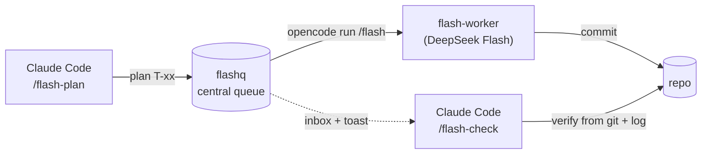

# flashq

[ภาษาไทย](README.md) | **English**

**A machine-wide job queue that hands work to [opencode](https://opencode.ai) (DeepSeek Flash) — for every project and every model account on one machine.**

Let [Claude Code](https://claude.com/claude-code) do the planning and the reviewing, and push the token-heavy hands-on coding into a queue run by a model with a much larger quota. No quota collisions, no file conflicts, no babysitting.

  

> **Note:** the CLI output, web UI and most docs are in Thai. Command names, flags and file formats are in English.

## How it works



1. **Claude plans** — `/flash-plan` confirms where the change goes, then writes a spec split into tasks `T-01`, `T-02`, …
2. **flashq queues** — the plan enters the machine-wide queue, which assigns run slots, avoids file conflicts, and switches accounts when a quota runs out.
3. **Flash executes** — `flash-worker` follows the plan inside opencode and commits.
4. **Claude reviews** — when the job finishes, flashq notifies back on its own (no tokens burned while waiting), and `/flash-check` verifies against real evidence — not the model's own claims.

## Features

- **One queue per machine** — all projects share the same set of model accounts. Default is one job at a time (FIFO); up to 8 parallel slots.
- **Automatic scheduling** — skips jobs that touch the same files as a running job and starts the first non-conflicting one, with starvation protection.
- **Account switching on quota exhaustion** — `--switch-on-quota` retries on the next account; tasks already ticked `[x]` are skipped.
- **Real stuck-job detection** — distinguishes "tool hung" from "waiting on the model", asks the opencode server before killing anything, and kills only the stuck shell command, not the whole job.
- **Multiple roles** — worker · verifier · investigator · tester · doc writer (see the table below).
- **Goal mode** — set measurable acceptance criteria and let Flash loop until they pass, with brakes for repeated failures, budget limits, or scope drift.
- **Notifies you back** — inbox + Windows toast + a hook that injects results into your Claude session.
- **Web dashboard** — live queue, logs, stats, and an "office" cartoon scene showing who is doing what (pure stdlib, loads nothing from the internet).
- **Token and savings tracking** — how many tokens Flash used and an estimate of what you saved versus having Claude do it.
- **Zero dependencies** — Python stdlib only (except `flashq gui`, which needs `pywebview`, or use the exe bundle).

## Getting started

### Requirements

- Python 3
- [opencode](https://opencode.ai) with model accounts already configured
- [Claude Code](https://claude.com/claude-code) (for the `/flash-*` commands)
- Windows — toasts, the shell watchdog and the desktop launcher are developed and tested on Windows

> Don't want to install Python? Use the **exe bundle** (`flashq-gui.exe` opens the app window, `flashq.exe` for the CLI) — see [docs/INSTALL_EXE.md](docs/INSTALL_EXE.md) (Thai).

### Install

```bash
git clone https://github.com/makerwitawat/flashq.git
cd flashq
python flashq.py install --hooks
```

`install` copies the commands and agents into `~/.claude/` and `~/.config/opencode/` globally; `--hooks` registers hooks in `~/.claude/settings.json`. Then reload opencode / start a new Claude Code session.

> Always install from flashq's real location (the checkout or the exe bundle folder) — that path is embedded into the installed files. If you move the folder later, run `install` again.

### Set up a project

```bash
cd <your-project>
python <path-to-flashq>/flashq.py init --install --commit
```

Or type `/flash-init` in Claude Code inside that project. `init` detects the main branch and remote from git, creates `.flash.json`, adds `.tmp/` to `.gitignore`, and copies the plan templates into `docs/plans/`.

### Send a job

```bash
# connectivity test
python flashq.py run --message "Reply with just PONG"

# run a real plan
python flashq.py run docs/plans/PLAN_X.md T-01..T-03

# status: what's running + queue + accounts
python flashq.py
```

You can run it directly from a normal terminal. Inside Claude Code it must run in the background (the `hooks/run_guard.py` guard blocks foreground `run` commands issued through Claude Code only) — `/flash-plan` handles this for you.

Or in Claude Code: `/flash-plan <what you want>` and wait for the notification.

### Web UI / app window

```bash
python flashq.py ui     # open in the browser
python flashq.py gui    # app window (WebView2 via pywebview · pip install pywebview)
```

`ui` opens `http://127.0.0.1:4097/` (binds to 127.0.0.1 only), or double-click `flashq-ui.bat`. `gui` picks a free port (override with `--port`) and doesn't use a browser; double-clicking `flashq-gui.exe` in the exe bundle starts this mode.

## Commands

| Command | What it does |
|---|---|
| `run <plan> [T-xx..]` | Queue a work job |
| `verify` | Send an independent (read-only) verifier |
| `investigate "<brief>"` | Send an investigator to find a bug's root cause (read-only) |
| `qa [suite...]` | Run the project's test suites; verdict from the real exit code |
| `doc [preset]` | Doc writer updates docs to match the code, then waits for you to accept/discard |
| `goal check\|verify\|status\|cancel` | Goal mode |
| `status` · `list` · `log <id>` · `why [id]` | Queue, history, logs, and diagnosis of running jobs |
| `cancel <id>` · `runnow <id>` · `wait <id\|plan>` | Cancel · run now in a spare slot · block until done |
| `usage <plan>` · `usage --flash` | Claude tokens per plan · Flash tokens and savings |
| `switch [next\|...]` · `config` | Switch model account · view/set config (`max_parallel`, `schedule`) |
| `keys [--probe]` | Check every account's key (unusable key = `FLASH_RUN=AUTH`) · warn when an old key in opencode v2's credential store overrides `opencode.json` |
| `models` | List every model on this machine and pick which role uses which (`--list` `--auto` `--set`) |
| `ui` · `gui` | Browser dashboard · browserless app window (`--port` · `gui` needs pywebview) |
| `install` · `init` · `prune` · `shrink` | Install (checks models at the end) · set up a project · purge old history · shrink images before Claude reads them |

`run` output ends with a `FLASH_RUN=OK|FAIL|QUOTA|AUTH|TIMEOUT|NOSTART|DENIED|BUSY|QUEUE_TIMEOUT` line and `job=<id>` (exit 0 = OK).

### Agent roles

| Agent | Role | Permissions |
|---|---|---|
| `flash-worker` | Executes the plan | Edit code + commit |
| `flash-verifier` | Independently looks for mistakes | Read-only |
| `flash-investigator` | Traces bug root causes with file:line citations | Read-only |
| `flash-tester` | Explains why a test suite failed | Read-only |
| `flash-writer` | Updates docs to match the code | Edits only paths allowed by the preset |

Verifier/investigator output is supporting evidence, not a verdict — Claude owns the work and must read the code itself before trusting it.

### Claude Code commands

| Command | What it does |
|---|---|
| `/flash-plan` | Plan, queue the job, and wait for the notification |
| `/flash-check` | Verify results from git + log evidence, then fix up to 2 rounds |
| `/flash-goal` | Set a goal and loop until the criteria pass |
| `/flash-investigate` · `/flash-qa` · `/flash-doc` | Dispatch the investigator · tester · doc writer |
| `/flash-boss` | The boss: state your need once, it clarifies, splits work by role, dispatches via the commands above, and delivers verified results |
| `/flash-init` | Set up a new project |

In opencode: `/flash` · `/flash-queue` · `/flash-switch`, plus the same orchestrator commands as Claude Code (`/flash-plan`, `/flash-check`, … — created by `install`), so another model such as GLM can act as the orchestrator instead of Claude. The orchestrator submits with `run --detach` and reads results with `flashq inbox`. Jobs submitted with `--detach` never open an extra session window (configurable: the "session window" toggle in the web UI · `open_session` in `.flash.json` per project · `flashq config open_session off`).

## Configuration

Per-project settings live in `.flash.json` at the project root (all fields optional — `flashq init` creates it):

```json
{
  "main_branch": "main",
  "remote": "origin",
  "require_plan_in_remote": true,
  "timeout_min": 480,
  "rules": "Extra rules the worker must follow, e.g. the project's commit command",
  "external_dirs": ["D:/MyCode/shared-lib/*"]
}
```

Machine settings (`max_parallel`, `schedule`, `variants`, `prices`, `notify`, …) live in `~/.flashq/config.json` and can be set from the CLI:

```bash
python flashq.py config max_parallel 2     # run 2 jobs in parallel (1-8)
python flashq.py config schedule auto      # automatic scheduling
```

Runtime data (jobs · logs · inbox · stats) is stored in `~/.flashq/`, outside git — relocate it with the `FLASHQ_HOME` environment variable.

The model account list used by `flashq switch` is in `accounts.json` (order = switch order). If your providers differ, `flashq models` writes `~/.flashq/accounts.json` to override it.

## Documentation

All documents below are in Thai.

| Document | Contents |
|---|---|
| [docs/REFERENCE.md](docs/REFERENCE.md) | Full reference: scheduler · goal mode · qa/doc/verify/investigate · web UI · `DENIED` permissions · all settings |
| [docs/ARCHITECTURE.md](docs/ARCHITECTURE.md) | Code structure · data files · web UI API · environment variables |
| [docs/INSTALL_EXE.md](docs/INSTALL_EXE.md) | Install from the exe bundle (`flashq-gui.exe` / `flashq.exe`) — no Python needed |
| [CHANGELOG.md](CHANGELOG.md) | Changes by date |
| [AGENTS.md](AGENTS.md) | Rules for humans/AI editing this repo |
| [templates/](templates) | [Plan](templates/FLASH_PLAN_TEMPLATE.md) and [goal](templates/GOAL_TEMPLATE.md) templates |

## Development

```bash
python -m pytest tests/test_flashq.py -q            # full suite, ~6 minutes
python -m pytest tests/test_flashq.py -q -k "<kw>"  # a subset
```

Tests use a fake opencode (no real model calls) and point `FLASHQ_HOME` at a temporary folder, so your real `~/.flashq` is never touched. See [AGENTS.md](AGENTS.md) for contribution rules.
