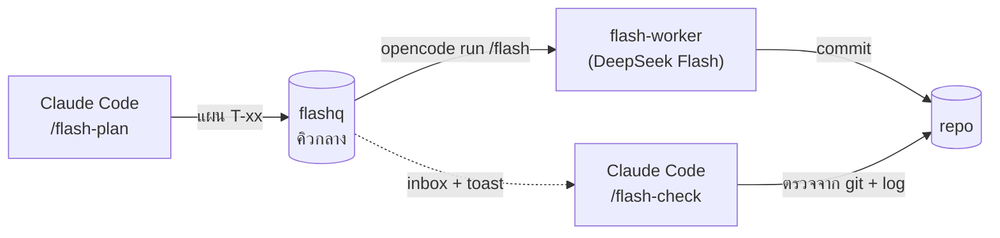

# flashq

**คิวกลางส่งงานให้ [opencode](https://opencode.ai) (DeepSeek Flash) — ใช้ได้ทุกโปรเจกต์ ทุกบัญชีโมเดล ในเครื่องเดียว**

ให้ [Claude Code](https://claude.com/claude-code) เป็นคนวางแผนและตรวจผล ส่วนงานลงมือแก้โค้ดที่ใช้ token เยอะ ส่งเข้าคิวให้โมเดลที่โควตาเยอะกว่าทำแทน — ไม่ชนโควตา ไม่ชนไฟล์ ไม่ต้องนั่งเฝ้า

  

## ทำงานอย่างไร



1. **Claude วางแผน** — `/flash-plan` ยืนยันจุดที่ต้องแก้ แล้วเขียนแผนเป็นสเปกแบ่งงานเป็น `T-01`, `T-02`, …
2. **flashq จัดคิว** — รับแผนเข้าคิวกลางของเครื่อง จัดช่องรัน กันไฟล์ชน สลับบัญชีเมื่อโควตาหมด
3. **Flash ลงมือ** — `flash-worker` ทำตามแผนใน opencode แล้ว commit
4. **Claude ตรวจ** — งานจบ flashq แจ้งกลับเอง (ไม่เสีย token ระหว่างรอ) แล้ว `/flash-check` ตรวจจากหลักฐานจริง ไม่ใช่คำบอกของโมเดล

## จุดเด่น

- **คิวเดียวทั้งเครื่อง** — ทุกโปรเจกต์ใช้บัญชีโมเดลชุดเดียวกัน ค่าเริ่มต้นทำทีละงานตามลำดับ (FIFO) รันคู่ขนานได้ถึง 8 ช่อง
- **จัดคิวอัตโนมัติ** — ข้ามงานที่ชนไฟล์กับงานที่กำลังทำ เริ่มงานแรกที่ไม่ชน พร้อมกลไกกันงานอดตาย
- **สลับบัญชีเมื่อโควตาหมด** — `--switch-on-quota` สั่งซ้ำต่อให้เอง งานที่ติ๊ก `[x]` แล้วจะถูกข้าม
- **จับงานค้างได้จริง** — แยก "tool ค้าง" ออกจาก "รอโมเดล" ถาม opencode server ก่อนฆ่า และฆ่าเฉพาะคำสั่ง shell ที่ค้าง ไม่ฆ่าทั้งงาน
- **หลายบทบาท** — ผู้ทำ · ผู้ตรวจ · ผู้สืบ · นักทดสอบ · ช่างเอกสาร (ดูตารางด้านล่าง)
- **โหมดเป้าหมาย** — ตั้งธงเกณฑ์ที่วัดได้ แล้ววนให้ Flash ทำจนผ่าน มีเบรกเมื่อพังซ้ำ ครบงบ หรือหลุดขอบเขต
- **แจ้งผลกลับเอง** — inbox + toast ของ Windows + hook ที่แทรกผลเข้า session ของ Claude
- **หน้าเว็บ dashboard** — ดูคิว log สด สถิติ และ "ออฟฟิศ" ฉากการ์ตูนที่โชว์ว่าใครกำลังทำอะไร (stdlib ล้วน ไม่โหลดอะไรจากเน็ต)
- **วัด token และการประหยัด** — บอกว่า Flash ใช้ไปเท่าไร และประมาณว่าประหยัดเทียบกับให้ Claude ทำเองไปเท่าไร
- **ไม่มี dependency** — Python stdlib อย่างเดียว (ยกเว้น `flashq gui` ที่ต้องติดตั้ง `pywebview` หรือใช้ชุดแจก exe)

## เริ่มต้นใช้งาน

### สิ่งที่ต้องมี

- Python 3
- [opencode](https://opencode.ai) ที่ตั้งค่าบัญชีโมเดลไว้แล้ว
- [Claude Code](https://claude.com/claude-code) (ถ้าจะใช้คำสั่ง `/flash-*`)
- Windows — toast, ตัวเฝ้า shell และ desktop launcher พัฒนาและทดสอบบน Windows

> ไม่อยากติดตั้ง Python? ใช้ **ชุดแจก exe** (`flashq-gui.exe` ดับเบิลคลิกเปิดหน้าต่างแอป + `flashq.exe` สำหรับคำสั่ง) — วิธีติดตั้งดู [docs/INSTALL_EXE.md](docs/INSTALL_EXE.md)

### ติดตั้ง

```bash
git clone https://github.com/makerwitawat/flashq.git
cd flashq
python flashq.py install --hooks
```

`install` คัดลอกคำสั่งและ agent ไปไว้ที่ `~/.claude/` และ `~/.config/opencode/` แบบ global ส่วน `--hooks` ลงทะเบียน hook ใน `~/.claude/settings.json` แล้วรีโหลด opencode / เปิด Claude Code session ใหม่

> ติดตั้งจากที่อยู่จริงของ flashq เสมอ (checkout หรือโฟลเดอร์ชุดแจก exe) — path นั้นจะถูกฝังลงในไฟล์ที่ติดตั้ง ย้ายโฟลเดอร์ภายหลัง = รัน `install` ใหม่

### ตั้งค่าโปรเจกต์

```bash
cd <โฟลเดอร์โปรเจกต์>
python <path-to-flashq>/flashq.py init --install --commit
```

หรือพิมพ์ `/flash-init` ใน Claude Code ที่โปรเจกต์นั้น `init` ตรวจ branch หลักและ remote จาก git เองแล้วสร้าง `.flash.json`, เพิ่ม `.tmp/` ใน `.gitignore` และคัดลอกแม่แบบแผนไป `docs/plans/`

### ลองส่งงาน

```bash
# ทดสอบการเชื่อมต่อ
python flashq.py run --message "ตอบแค่คำว่า PONG"

# ส่งแผนจริง
python flashq.py run docs/plans/PLAN_X.md T-01..T-03

# ดูสถานะ: กำลังทำอะไร + คิว + บัญชี
python flashq.py
```

รันจาก terminal ปกติได้ตรง ๆ · ใน Claude Code ต้องรันแบบ background (ยาม `hooks/run_guard.py` บล็อกคำสั่ง run แบบ foreground ที่ส่งผ่าน Claude Code เท่านั้น) — ใช้ `/flash-plan` จะจัดให้เอง

หรือใน Claude Code: `/flash-plan <งานที่ต้องการ>` แล้วรอระบบแจ้งผล

### เปิดหน้าเว็บ / หน้าต่างแอป

```bash
python flashq.py ui     # เปิดในเบราว์เซอร์
python flashq.py gui    # หน้าต่างแอป (WebView2 ผ่าน pywebview · pip install pywebview)
```

`ui` เปิด `http://127.0.0.1:4097/` (bind เฉพาะ 127.0.0.1) หรือดับเบิลคลิก `flashq-ui.bat` · `gui` ใช้พอร์ตว่างเอง (`--port` กำหนดได้) ไม่ใช้เบราว์เซอร์ · ดับเบิลคลิก `flashq-gui.exe` ในชุดแจก exe = โหมดนี้

## คำสั่ง

| คำสั่ง | ทำอะไร |
|---|---|
| `run <แผน> [T-xx..]` | ส่งงานทำเข้าคิว |
| `verify` | ส่งผู้ตรวจอิสระ (อ่านอย่างเดียว) |
| `investigate "<บรีฟ>"` | ส่งผู้สืบไล่หาต้นตอบั๊ก (อ่านอย่างเดียว) |
| `qa [ชุด...]` | รันชุดทดสอบของโปรเจกต์ ตัดสินจาก exit code จริง |
| `doc [ชุด]` | ช่างเอกสารอัปเดตเอกสารให้ตรงโค้ด แล้วรอคุณรับ/ทิ้ง |
| `goal check\|verify\|status\|cancel` | โหมดเป้าหมาย |
| `status` · `list` · `log <id>` · `why [id]` | ดูคิว ประวัติ log และวินิจฉัยงานที่รันอยู่ |
| `cancel <id>` · `runnow <id>` · `wait <id\|แผน>` | ยกเลิก · รันทันทีในช่องพิเศษ · บล็อกรอจนจบ |
| `usage <แผน>` · `usage --flash` | token ของ Claude ต่อแผน · token ของ Flash และยอดประหยัด |
| `switch [next\|...]` · `config` | สลับบัญชีโมเดล · ดู/ตั้งค่า (`max_parallel`, `schedule`) |
| `models` | แสดงโมเดลทั้งหมดที่เครื่องนี้มี แล้วเลือกว่าบทบาทไหนใช้โมเดลอะไร (`--list` `--auto` `--set`) |
| `ui` · `gui` | หน้าเว็บ dashboard ในเบราว์เซอร์ · หน้าต่างแอปแบบไม่ใช้เบราว์เซอร์ (`--port` · `gui` ต้องมี pywebview) |
| `install` · `init` · `prune` · `shrink` | ติดตั้ง (ท้ายงานตรวจโมเดลให้) · ตั้งค่าโปรเจกต์ · ล้างประวัติเก่า · ย่อรูปก่อนให้ Claude อ่าน |

ผลลัพธ์ของ `run` ลงท้ายด้วยบรรทัด `FLASH_RUN=OK|FAIL|QUOTA|TIMEOUT|NOSTART|DENIED|BUSY|QUEUE_TIMEOUT` และ `job=<id>` (exit 0 = OK)

### บทบาทของ agent

| Agent | หน้าที่ | สิทธิ์ |
|---|---|---|
| `flash-worker` | ลงมือทำตามแผน | แก้โค้ด + commit |
| `flash-verifier` | ตรวจหาข้อผิดแบบอิสระ | อ่านอย่างเดียว |
| `flash-investigator` | ไล่หาต้นตอบั๊กพร้อมอ้างไฟล์:บรรทัด | อ่านอย่างเดียว |
| `flash-tester` | อธิบายสาเหตุที่ชุดทดสอบล้ม | อ่านอย่างเดียว |
| `flash-writer` | อัปเดตเอกสารให้ตรงโค้ด | แก้ได้เฉพาะ path ที่ชุดอนุญาต |

ผลจากผู้ตรวจ/ผู้สืบเป็นข้อมูลประกอบ ไม่ใช่คำตัดสิน — Claude เป็นเจ้าของงานและต้องเปิดดูโค้ดเองก่อนเชื่อ

### คำสั่งใน Claude Code

| คำสั่ง | ทำอะไร |
|---|---|
| `/flash-plan` | วางแผน แล้วส่งเข้าคิวและรอระบบแจ้งผล |
| `/flash-check` | ตรวจผลจากหลักฐาน git + log แล้วแก้ต่อได้ไม่เกิน 2 รอบ |
| `/flash-goal` | ตั้งธงแล้ววนจนผ่านเกณฑ์ |
| `/flash-investigate` · `/flash-qa` · `/flash-doc` | สั่งผู้สืบ · นักทดสอบ · ช่างเอกสาร |
| `/flash-boss` | หัวหน้า: บอกความต้องการครั้งเดียว ถามให้ชัด แบ่งงานตามบทบาท จ่ายผ่านคำสั่งข้างบน แล้วส่งมอบผลที่ตรวจแล้ว |
| `/flash-init` | ตั้งค่าโปรเจกต์ใหม่ |

ใน opencode: `/flash` · `/flash-queue` · `/flash-switch` และคำสั่งฝั่งผู้สั่งชุดเดียวกับ Claude Code (`/flash-plan` `/flash-check` ฯลฯ — `install` สร้างให้) ทำให้โมเดลอื่นเช่น GLM เป็นผู้สั่งแทน Claude ได้ · ผู้สั่งส่งงานด้วย `run --detach` แล้วดูผลด้วย `flashq inbox` · ไม่อยากให้เปิดหน้าต่าง session ซ้อน: งานที่ส่งด้วย `--detach` ไม่เปิดให้เองอยู่แล้ว (ตั้งเองได้: สวิตช์ "หน้าต่าง session" บนหน้าเว็บ · `.flash.json` `open_session` ต่อโปรเจกต์ · `flashq config open_session off`

## ตั้งค่า

ค่าเฉพาะโปรเจกต์อยู่ใน `.flash.json` ที่รากโปรเจกต์ (ทุกช่องไม่บังคับ — `flashq init` สร้างให้):

```json
{
  "main_branch": "main",
  "remote": "origin",
  "require_plan_in_remote": true,
  "timeout_min": 480,
  "rules": "กติกาเพิ่มที่ worker ต้องทำตาม เช่น คำสั่ง commit ของโปรเจกต์",
  "external_dirs": ["D:/MyCode/shared-lib/*"]
}
```

ค่าของเครื่อง (`max_parallel`, `schedule`, `variants`, `prices`, `notify` ฯลฯ) อยู่ที่ `~/.flashq/config.json` ตั้งผ่าน CLI ได้:

```bash
python flashq.py config max_parallel 2     # รันพร้อมกัน 2 งาน (1-8)
python flashq.py config schedule auto      # จัดคิวอัตโนมัติ
```

ข้อมูลตอนรัน (งาน · log · inbox · สถิติ) เก็บที่ `~/.flashq/` ไม่อยู่ใน git — ย้ายที่ได้ด้วยตัวแปร `FLASHQ_HOME`

## เอกสาร

| เอกสาร | เนื้อหา |
|---|---|
| [docs/REFERENCE.md](docs/REFERENCE.md) | คู่มืออ้างอิงฉบับเต็ม: ตัวจัดคิว · โหมดเป้าหมาย · qa/doc/verify/investigate · หน้าเว็บ · สิทธิ์ `DENIED` · ค่าตั้งทั้งหมด |
| [docs/ARCHITECTURE.md](docs/ARCHITECTURE.md) | โครงสร้างโค้ด · ไฟล์ข้อมูล · API ของหน้าเว็บ · ตัวแปรแวดล้อม |
| [docs/INSTALL_EXE.md](docs/INSTALL_EXE.md) | ติดตั้งจากชุดแจก exe (`flashq-gui.exe` / `flashq.exe`) — ไม่ต้องมี Python |
| [CHANGELOG.md](CHANGELOG.md) | สิ่งที่เปลี่ยนตามวัน |
| [AGENTS.md](AGENTS.md) | กติกาสำหรับคน/AI ที่แก้ repo นี้ |
| [templates/](templates) | แม่แบบ[แผน](templates/FLASH_PLAN_TEMPLATE.md)และ[เป้าหมาย](templates/GOAL_TEMPLATE.md) |

## พัฒนา

```bash
python -m pytest tests/test_flashq.py -q            # ทั้งชุดใช้เวลาราว 6 นาที
python -m pytest tests/test_flashq.py -q -k "<คำ>"  # เลือกบางข้อ
```

เทสต์ใช้ opencode ปลอม ไม่เรียกโมเดลจริง และตั้ง `FLASHQ_HOME` เป็นโฟลเดอร์ชั่วคราวเอง ไม่แตะ `~/.flashq` จริง — รายละเอียดการแก้ repo นี้ดู [AGENTS.md](AGENTS.md)
